# SATNET

---

3D satellite plotting application with the ability to highlight specific satellites and display detailed information.

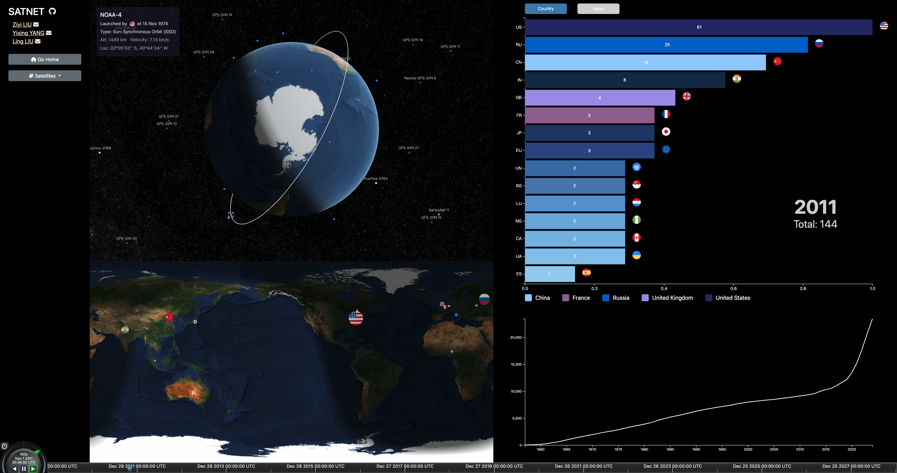


# Run the Project
## Installation Dependencies

```bash
npm install
```

## Scripts Supported by npm

- **start**: Starts the Vite development server `npm start` or `npm run dev`.
- **build**: Builds the project for production `npm run build`.
- **serve**: Serves the built project for preview `npm run serve`.

  After running `npm run build`, the project will be built in the `dist` directory. You can preview the built project by running `npm run serve`.
- After script running, the webpage can be shown in the ***[http://localhost:4170/](http://localhost:4170/)***.

# Visualization

## 3D Globe

### 3D Globe Zoom Levels

<div align="center">
  <table>
    <tr>
      <td align="center" width="45%">
        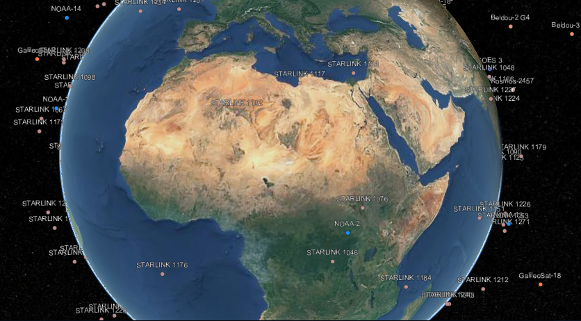<br>
        <b>(a)</b> Zoomed-in View
      </td>
      <td align="center" width="45%">
        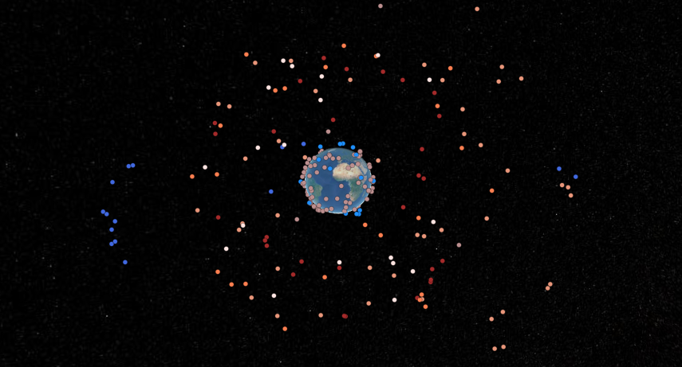<br>
        <b>(b)</b> Zoomed-out View
      </td>
    </tr>
  </table>
</div>

---

### Satellite Orbits with Information Card

<div align="center">
  <table>
    <tr>
      <td align="center" width="45%">
        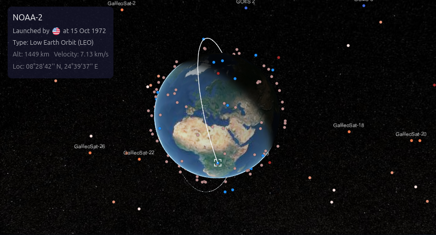<br>
        <b>(a)</b> Low Earth Orbit (LEO)
      </td>
      <td align="center" width="45%">
        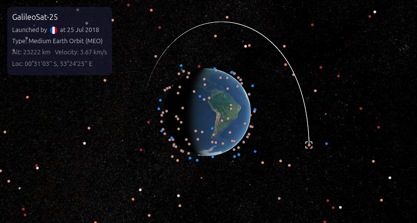<br>
        <b>(b)</b> Medium Earth Orbit (MEO)
      </td>
    </tr>
    <tr>
      <td align="center" width="45%">
        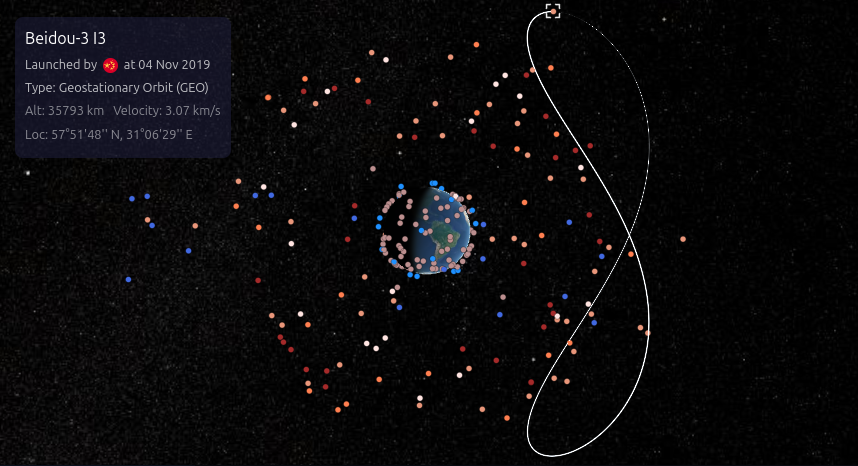<br>
        <b>(c)</b> Geostationary Orbit (GEO)
      </td>
      <td align="center" width="45%">
        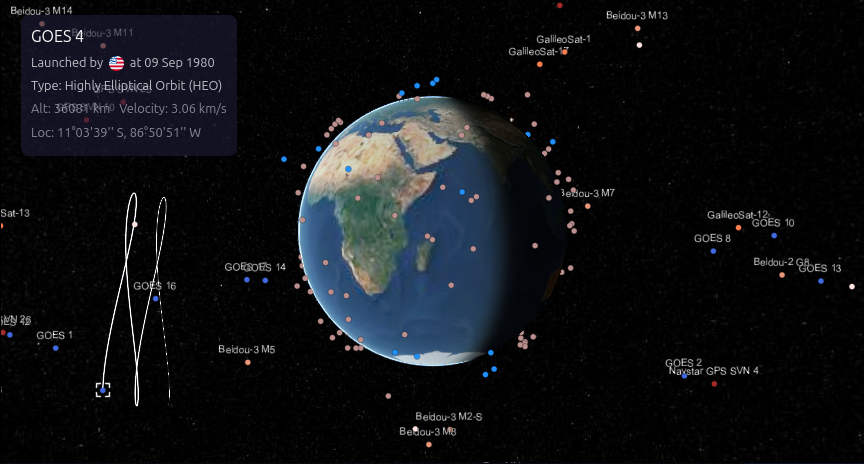<br>
        <b>(d)</b> High Orbit (HEO)
      </td>
    </tr>
  </table>
</div>

## 2D Map
### Satellite Launching Animation
<div align="center">
  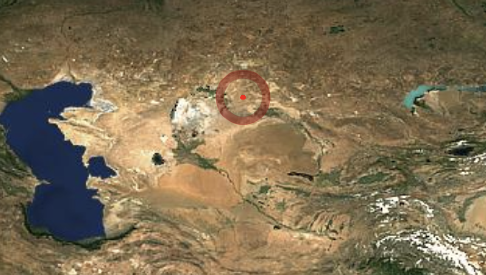<br>
</div>

The launch animation is driven by time and location on Earth. Once the launch time matches the Cesium global clock, the animation begins, and new entities are added to the 2D Cesium Viewer. 

### Country Circles

<div align="center">
  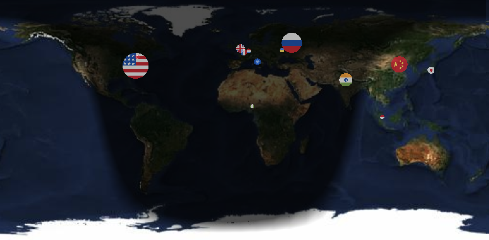<br>
</div>

The size of the country circle represents the number of satellites launched in the previous year, with the circle's center placed at the geographical coordinates of each country's capital.

### Barchart: Ranking Launches by Country and Agent

<div align="center">
  <table>
    <tr>
      <td align="center" width="40%">
        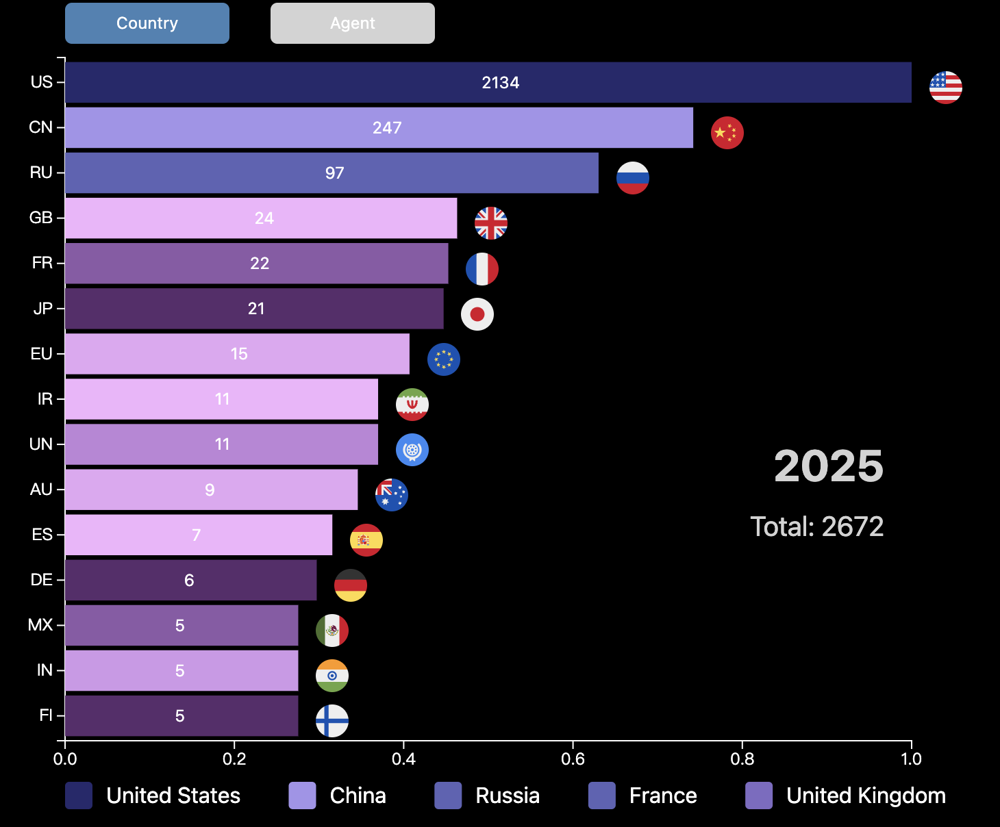<br>
        <b>(a)</b> Number of satellites launched by each country
      </td>
      <td width="5%"></td>
      <td align="center" width="40%">
        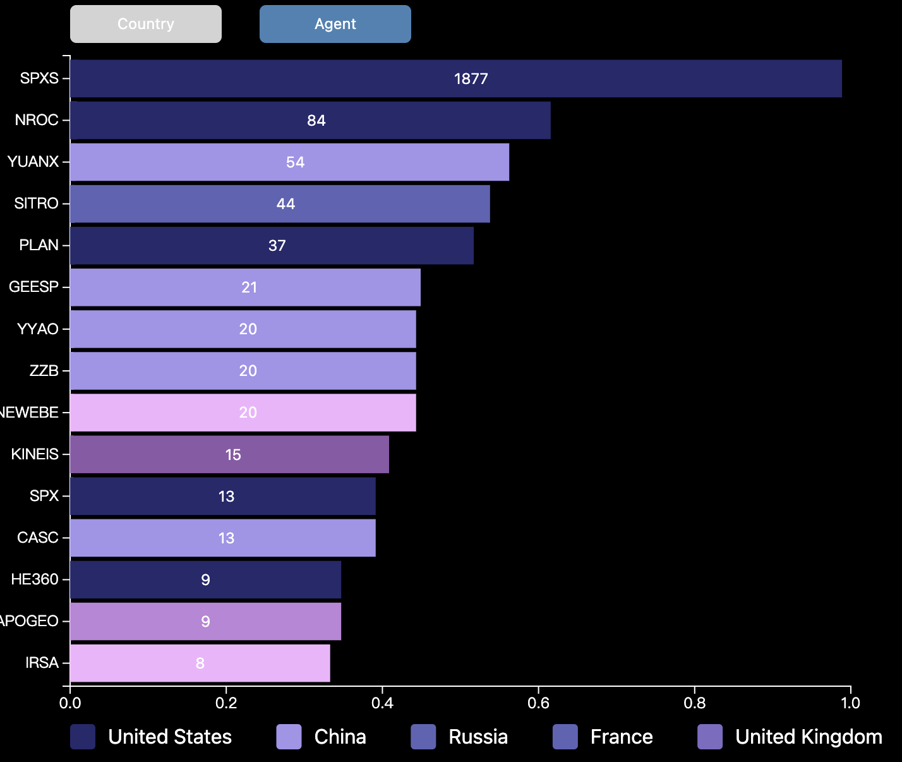<br>
        <b>(b)</b> Number of satellites launched by agents
      </td>
    </tr>
  </table>
</div>

The barchart dynamically ranks satellite launches by country and agent on a yearly basis. Users can toggle between country and agent views and apply filters to selectively display or hide certain entities.

<!-- # Functions TODOs
## 3D Animation
- 3D satellite plotting (Current)
  - Highlight specific satellite (by click): highlight its detailed information.

- 3D Filter by time (launched / not at a past time)


## Data Analysis
- Launch **location** on 2D by time [2D-time]
  e.g. https://celestrak.org/satcat/launchsites.php
  
- Stat char/graph animation by time
  
  numbers of launches, like: 人口图 [#launches in country - time]
  
  global number of active satellites [#all launches - time]
  
  number of satellites [#launches in types - time] -->


# Websites for Reference
## Examples / its Github repo

- https://www.starlinkmap.org/
- https://github.com/Flowm/satvis
- https://spaceaware.io/

### Others
- https://github.com/jeremysuh/3D-Satellite-Tracker
- https://github.com/andrewkihs/satellite-radio
- https://github.com/RuiZhang2Penn/Shinning

## Data Souce
- https://celestrak.org/NORAD/elements/
- https://satdb.ethz.ch/
  Processed 'celestrak' data APIs
- https://github.com/r-spacex/SpaceX-API/tree/master/docs/starlink/v4
  might be official data
- https://planet4589.org/space/gcat/web/sites/index.html
  Launch sites

## The Earth texture
- https://planetpixelemporium.com/earth.html
